# DEVELOPMENT ROADMAP — AI Health Monitoring System

**Version:** 1.0  
**Date:** 2026-11-18

---

## Phase Overview

```mermaid
flowchart LR
    P1["Phase 1\nAudit"] --> P2["Phase 2\nArchitecture"]
    P2 --> P3["Phase 3\nSecurity"]
    P3 --> P4["Phase 4\nDB + Auth"]
    P4 --> P5["Phase 5\nBackend APIs"]
    P5 --> P6["Phase 6\nAI Chat"]
    P6 --> P7["Phase 7\nQuery Engine"]
    P7 --> P8["Phase 8\nEmergency"]
    P8 --> P9["Phase 9\nImage AI"]
    P9 --> P10["Phase 10\nDashboard"]
    P10 --> P11["Phase 11\nReports"]
    P11 --> P12["Phase 12\nFrontend"]
    P12 --> P13["Phase 13\nFunctional Test"]
    P13 --> P14["Phase 14\nSecurity Test"]
    P14 --> P15["Phase 15\nDocs + GitHub"]
    P15 --> P16["Phase 16\nCloud Prep"]
    P16 --> P17["Phase 17\nDeploy"]
```

---

## Detailed Phase Plan

### Phase 1 — Project Audit & MCP Discovery ✅ CURRENT
- [x] Inspect all local directories
- [x] Discover MCP servers and plugins
- [x] Check GitHub repositories
- [x] Identify available AI models
- [x] Audit development tools
- [x] Create PROJECT_AUDIT.md
- **Status:** Complete

### Phase 2 — Architecture & Technical Decisions ✅ CURRENT
- [x] Create SYSTEM_ARCHITECTURE.md
- [x] Define technology stack
- [x] Design database schema
- [x] Design API endpoints
- [x] Define AI processing pipeline
- [x] Plan security architecture
- [ ] **Obtain user approval on key decisions**
- **Status:** Awaiting approval

### Phase 3 — Security & Privacy Foundations
- [ ] Configure CORS, rate limiting, input validation middleware
- [ ] Set up Pydantic validation schemas
- [ ] Implement prompt injection detection
- [ ] Create privacy consent framework
- [ ] Document DPDPA compliance assessment
- **Deliverable:** SECURITY_AND_PRIVACY.md, middleware code

### Phase 4 — Database & Authentication
- [ ] Provision Supabase project (needs approval)
- [ ] Create all database tables with migrations
- [ ] Configure Row-Level Security policies
- [ ] Implement auth endpoints (register, login, logout, recovery)
- [ ] Set up email verification flow
- [ ] Create secure session management
- **Deliverable:** Working auth system, DATABASE_SCHEMA.md

### Phase 5 — Core Backend APIs
- [ ] Set up FastAPI project structure
- [ ] Implement user profile CRUD
- [ ] Implement conversation CRUD
- [ ] Implement health records CRUD
- [ ] Implement image upload with validation
- [ ] Set up structured error handling
- **Deliverable:** Complete REST API (without AI)

### Phase 6 — AI Health Conversation Engine
- [ ] Install and configure google-genai SDK
- [ ] Build modular AI service layer
- [ ] Design system prompts for health assistant
- [ ] Implement multi-turn conversation with context
- [ ] Build follow-up question logic
- [ ] Implement response structuring
- **Deliverable:** Working AI chat with real Gemini responses

### Phase 7 — AI Health Query Solution Engine
- [ ] Build structured health response format
- [ ] Implement symptom analysis workflow (10-step)
- [ ] Add medical knowledge source citations
- [ ] Implement context-aware response adaptation
- [ ] Build uncertainty and limitation handling
- **Deliverable:** Meaningful, structured health answers

### Phase 8 — Emergency Safety Engine
- [ ] Build deterministic keyword/pattern emergency detector
- [ ] Create emergency response templates
- [ ] Implement pre-AI safety screening
- [ ] Add emergency contact information (India-specific)
- [ ] Create emergency test suite
- **Deliverable:** Working emergency detection, HEALTHCARE_AI_SAFETY.md

### Phase 9 — Multimodal Image Assistance
- [ ] Implement secure image upload (JPG, PNG, WebP)
- [ ] Add file validation (type, size, dimensions)
- [ ] Integrate Gemini multimodal image analysis
- [ ] Build image-specific question handling
- [ ] Implement image safety guardrails
- **Deliverable:** Working image upload + AI analysis

### Phase 10 — User Dashboard & Health History
- [ ] Build dashboard with real data
- [ ] Implement conversation history view
- [ ] Add image analysis history
- [ ] Build vital signs entry and tracking
- [ ] Create health trends visualization
- **Deliverable:** Functional dashboard with actual data

### Phase 11 — Health Report Generation
- [ ] Implement server-side PDF generation (ReportLab)
- [ ] Build report content aggregation
- [ ] Add proper AI-generated disclaimer labeling
- [ ] Implement report download API
- **Deliverable:** Downloadable PDF health reports

### Phase 12 — Frontend Integration
- [ ] Build all pages with working navigation
- [ ] Connect all forms to backend APIs
- [ ] Implement real-time chat interface
- [ ] Build image upload with preview
- [ ] Add loading, error, empty states
- [ ] Responsive design (mobile, tablet, desktop)
- **Deliverable:** Complete, functional frontend

### Phase 13 — Complete Functional Testing
- [ ] Auth flow tests
- [ ] AI conversation tests
- [ ] Image upload/analysis tests
- [ ] Report generation tests
- [ ] User data management tests
- **Deliverable:** TESTING_REPORT.md

### Phase 14 — Security & AI Safety Testing
- [ ] Authentication bypass tests
- [ ] Data isolation tests
- [ ] Prompt injection tests
- [ ] Emergency detection tests
- [ ] Input validation tests
- **Deliverable:** Security test results in TESTING_REPORT.md

### Phase 15 — Documentation & GitHub
- [ ] Complete README.md
- [ ] API_DOCUMENTATION.md
- [ ] DEPLOYMENT_GUIDE.md
- [ ] CONTRIBUTING.md
- [ ] .gitignore and .env.example
- [ ] Push to GitHub
- **Deliverable:** Professional GitHub repository

### Phase 16 — Cloud Production Preparation
- [ ] Dockerfile for backend
- [ ] Vercel configuration for frontend
- [ ] Environment variable setup
- [ ] HTTPS verification
- [ ] Monitoring setup
- **Deliverable:** Deployment-ready configuration

### Phase 17 — Final Approval & Deployment
- [ ] User approval for deployment
- [ ] Deploy backend to Cloud Run
- [ ] Deploy frontend to Vercel
- [ ] End-to-end production testing
- [ ] Final FUNCTIONALITY_AUDIT.md update
- **Deliverable:** Live production application
