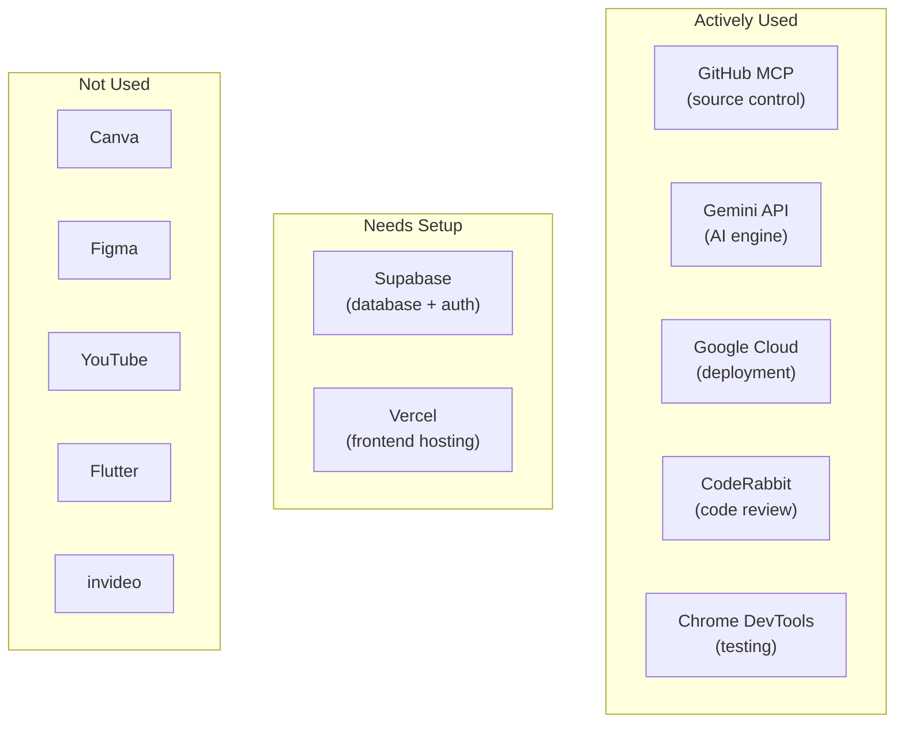

# MCP AND PLUGIN INVENTORY — AI Health Monitoring System

**Version:** 1.0  
**Date:** 2026-11-18

---

## 1. MCP Servers Available

| MCP Server | Status | Planned Usage |
|-----------|--------|---------------|
| `github-mcp-server` | ✅ Connected | Repository management, source control, issues |
| `gemini-api_gemini-api-docs` | ✅ Available | AI model documentation reference |
| `google-cloud-developer_developer-knowledge` | ✅ Available | GCP documentation and guidance |
| `chrome-devtools-mcp` | ✅ Available | Browser testing, debugging, performance |
| `canva_canva` | ✅ Available | Logo/branding assets if needed |
| `figma-dev-mode-mcp-server` | ✅ Available | Design reference if needed |
| `StitchMCP` | ✅ Available | UI design prototyping |
| `data-agent-kit-plugin_dak-notebook` | ✅ Available | Data analysis notebooks |
| `mobbin` | ✅ Available | UI/UX design research |
| `youtube-mcp` | ✅ Available | Not planned for this project |
| `vercel-plugin_vercel` | ⚠️ Not signed in | Frontend deployment (needs sign-in) |

---

## 2. Installed Plugins

| Plugin | Status | Relevance to Project |
|--------|--------|---------------------|
| `gemini-api` | ✅ Installed | **Critical** — AI model integration, SDK guidance |
| `firebase` | ✅ Installed | **High** — Auth, hosting, storage options |
| `google-cloud-developer` | ✅ Installed | **High** — Cloud Run deployment, GCP guidance |
| `coderabbit` | ✅ Installed | **Medium** — Code review before commits |
| `chrome-devtools-plugin` | ✅ Installed | **Medium** — UI testing and debugging |
| `canva` | ✅ Installed | **Low** — Branding assets only if needed |
| `gmail` | ✅ Connected | **Low** — Not core to this project |
| `vercel-plugin` | ⚠️ Not signed in | **High** — Frontend deployment |
| `google-antigravity-sdk` | ✅ Installed | **Low** — Agent SDK, not core |
| `google_maps_platform` | ✅ Installed | **None** — Not used |
| `flutter` | ✅ Installed | **None** — Not used (web project) |
| `invideo` | ✅ Installed | **None** — Not used |
| `data-agent-kit-plugin` | ✅ Installed | **Low** — Data analysis if needed |
| `modern-web-guidance-plugin` | ✅ Installed | **Medium** — Web best practices |

---

## 3. Connected Accounts

| Service | Account | Status |
|---------|---------|--------|
| Gmail (Google OAuth) | venkateshcl0408@gmail.com | ✅ Connected |
| GitHub | Venkatesh0408 | ✅ Connected (via MCP) |
| Vercel | — | ❌ Not signed in |
| Supabase | — | ❌ Not connected (manual setup needed) |
| Google Cloud | — | ❌ gcloud CLI not installed |

---

## 4. AI Models Available

### Recommended for This Project

| Model | Purpose | Capabilities |
|-------|---------|-------------|
| **gemini-4-hydrogen** | Primary AI engine | Text + image multimodal, 1M context, structured output, balanced cost |
| **gemini-4-argon** | Alternative (higher quality) | Stronger reasoning, higher cost |
| **gemini-4-carbon** | Alternative (highest quality) | Frontier reasoning, highest cost |
| **gemini-3.5-flash-lite** | Lightweight tasks | Emergency keyword validation, low-cost screening |

### Selected: `gemini-4-hydrogen`

**Justification:**
- Multimodal (text + image analysis) ✅
- 1M token context window (long conversations) ✅
- Structured output support (health response formatting) ✅
- Balanced cost/performance for a health information tool ✅
- Not a clinical model — appropriate disclaimers needed ⚠️

### SDK Required
- Python: `google-genai >= 3.2.0`
- Uses Interactions API (GA on v1)
- Structured output via `response_format`

---

## 5. Development Tools Available

| Tool | Version | Usage |
|------|---------|-------|
| Node.js | v26.13.1 | Frontend build tooling |
| npm | 11.20.0 | Package management |
| npx | 11.20.0 | CLI tool execution |
| Python | 3.12.10 | Backend runtime |
| Git | 2.56.0 | Version control |
| Docker | 29.9.3 | Containerization for deployment |

### Not Available (Need Installation)

| Tool | Purpose | Priority |
|------|---------|----------|
| google-genai SDK | Gemini API calls from Python | **Critical** — Phase 6 |
| gcloud CLI | Cloud Run deployment | Medium — Phase 16 |
| firebase CLI | Firebase setup (if used) | Low — only if Firebase chosen |
| vercel CLI | Frontend deployment | Medium — Phase 16 |

---

## 6. MCP Security Compliance

| Requirement | Status |
|-------------|--------|
| Least-privilege permissions | ✅ Each MCP used only for intended purpose |
| No credential exposure | ✅ API keys server-side only |
| No health data to unrelated services | ✅ Health data only to Gemini API + Supabase |
| Integration verification before use | ✅ All connections verified in this audit |
| Destructive actions require approval | ✅ Policy documented |
| Billable changes require approval | ✅ Policy documented |

---

## 7. Planned Integration Architecture

