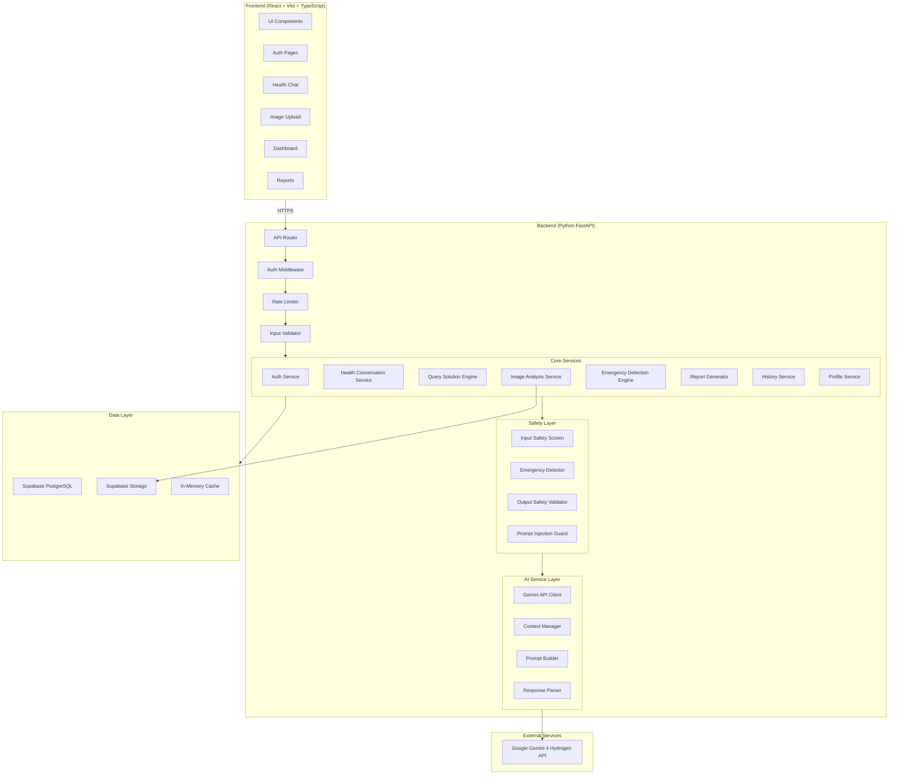
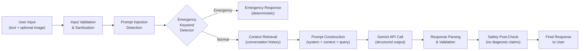
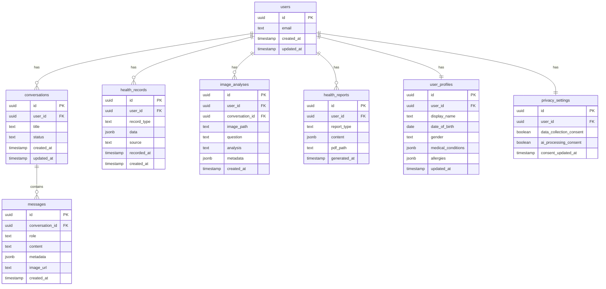
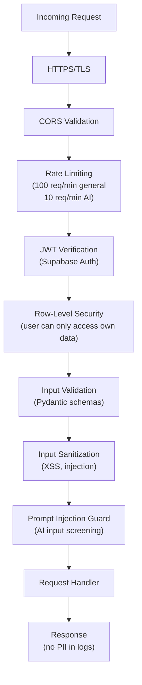
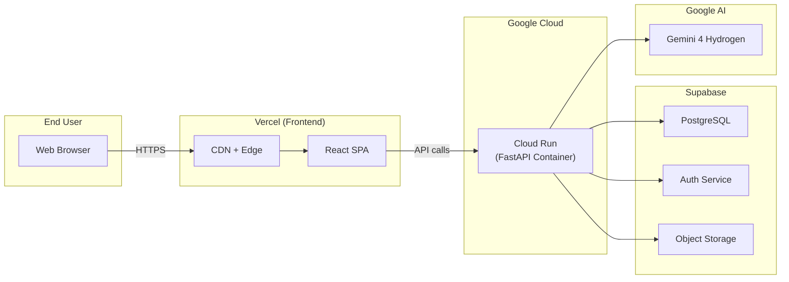

# SYSTEM ARCHITECTURE — AI Health Monitoring System

**Version:** 1.0  
**Date:** 2026-11-18

---

## 1. Architecture Overview

---

## 2. Technology Decisions

| Layer | Technology | Justification |
|-------|-----------|---------------|
| **Frontend** | React 18 + TypeScript + Vite | User familiarity, type safety, fast dev builds |
| **UI Components** | Shadcn/ui + Tailwind CSS | Accessible, composable, no vendor lock-in |
| **Backend** | Python 3.12 + FastAPI | Per requirements, async support, Pydantic validation |
| **Database** | Supabase (PostgreSQL 15+) | User experience with Supabase, RLS, built-in auth, storage |
| **Authentication** | Supabase Auth | Email/password, email verification, password recovery, JWT |
| **AI Model** | Gemini 4 Hydrogen | Multimodal (text + image), 1M token context, balanced cost |
| **AI SDK** | google-genai >= 3.2.0 (Python) | Official Google SDK, structured output, interactions API |
| **Image Storage** | Supabase Storage | Unified with database, RLS on buckets, CDN |
| **PDF Generation** | ReportLab (Python) | Server-side PDF, no browser dependency |
| **Deployment - Frontend** | Vercel | Static/SPA hosting, CDN, preview deploys |
| **Deployment - Backend** | Google Cloud Run | Docker container, auto-scaling, HTTPS |
| **Secrets** | Environment variables (.env) | Standard, no cloud-specific dependency initially |

---

## 3. AI Processing Pipeline

> [!IMPORTANT]
> Emergency detection uses a **deterministic keyword/pattern layer first**, not just the LLM. This ensures life-threatening symptom patterns are caught even if the AI model fails.

---

## 4. Database Schema (High-Level)

---

## 5. API Design

### Core Endpoints

| Method | Endpoint | Purpose |
|--------|----------|---------|
| POST | `/api/auth/register` | User registration |
| POST | `/api/auth/login` | User login |
| POST | `/api/auth/logout` | User logout |
| POST | `/api/auth/forgot-password` | Password recovery |
| GET | `/api/auth/verify-email` | Email verification |
| GET | `/api/users/profile` | Get user profile |
| PUT | `/api/users/profile` | Update user profile |
| DELETE | `/api/users/account` | Delete account + all data |
| GET | `/api/users/export` | Export all user data |
| POST | `/api/chat/conversations` | Start new conversation |
| GET | `/api/chat/conversations` | List conversations |
| GET | `/api/chat/conversations/:id` | Get conversation |
| POST | `/api/chat/conversations/:id/messages` | Send message (AI responds) |
| DELETE | `/api/chat/conversations/:id` | Delete conversation |
| POST | `/api/images/upload` | Upload health image |
| POST | `/api/images/analyze` | Analyze uploaded image with question |
| GET | `/api/images/analyses` | List past analyses |
| GET | `/api/health/records` | Get health records |
| POST | `/api/health/records` | Add health record (vitals, etc.) |
| GET | `/api/health/summary` | Get health summary |
| POST | `/api/reports/generate` | Generate PDF report |
| GET | `/api/reports` | List generated reports |
| GET | `/api/reports/:id/download` | Download PDF report |
| GET | `/api/privacy/settings` | Get privacy settings |
| PUT | `/api/privacy/settings` | Update privacy settings |

---

## 6. Security Architecture

---

## 7. Frontend Page Architecture

| Page | Route | Auth Required |
|------|-------|---------------|
| Landing | `/` | No |
| Login | `/login` | No |
| Register | `/register` | No |
| Dashboard | `/dashboard` | Yes |
| Health Chat | `/chat` | Yes |
| Chat Session | `/chat/:id` | Yes |
| Image Analysis | `/images` | Yes |
| Health History | `/history` | Yes |
| Health Reports | `/reports` | Yes |
| User Profile | `/profile` | Yes |
| Privacy Settings | `/privacy` | Yes |
| Emergency Info | `/emergency` | No |
| About & Disclaimer | `/about` | No |

---

## 8. Deployment Topology

